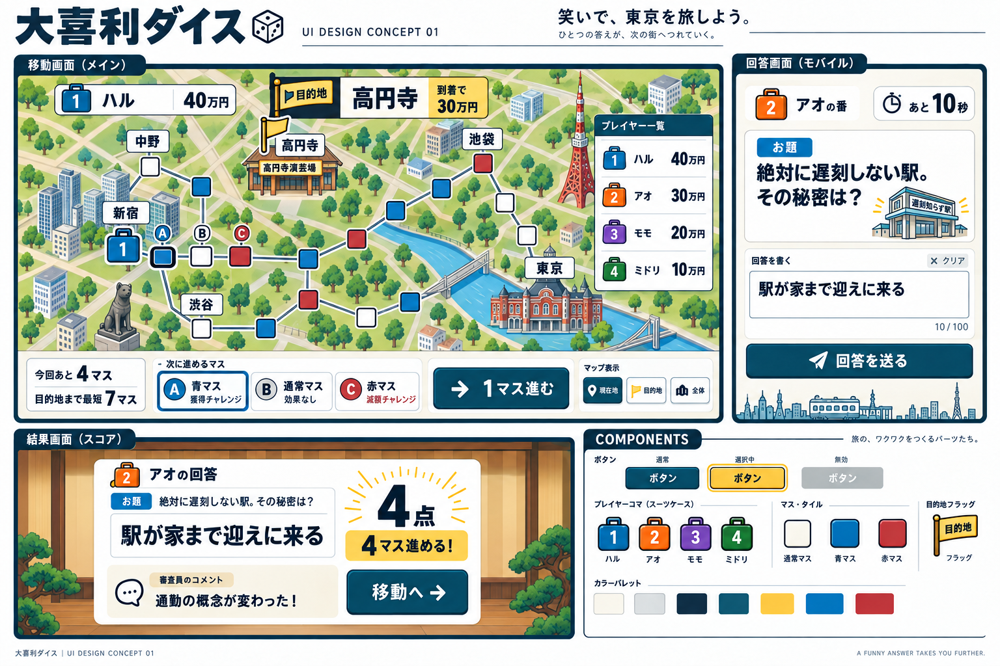

# UIコンセプト 01

> 不採用・履歴資料。ユーザーからAI生成の装飾的な画面ではなく家庭用ゲームUIを求める指摘を受けたため、本画像を今後の素材や部品の原型として使用しない。新しい根拠は[実画面分析](../../research/2026-09-25-console-ui-screen-analysis.md)、設計案は[共通UI部品設計](../../superpowers/specs/2026-09-25-game-ui-components-design.md)を参照。

2026-09-25 / ビジュアル確認用。ゲーム実装・完成アセットではない。

[デザインボード](ui-concept-01.png)

## 内容

- 4人対戦の移動画面：旅行かばん型コマ、目的地看板、候補選択と決定、所持金一覧。
- スマートフォンの回答画面：お題・残秒・入力・送信を一画面に配置。
- 採点結果：回答文、点数、移動数、審査コメント、次の操作。
- 共通部品：ボタン、番号付きコマ、マス、目的地、配色。

既存ゲーム画面・素材を参照画像として使わず、imagegenで新規生成したコンセプトを一度修正。初稿の過密な地図、回答文字数、候補記号、人物の審査員を整理した。

## 採用候補

濃いインク色と明るい面、旅行かばんの番号による識別、劇場の表現、地図とは別領域に置いた操作。数値や文章を大きく読ませる方向。

## 仕様との未解決の差分

この画像をそのまま実装仕様・ゲームデータにはしない。正本は[デザイン仕様書](../../superpowers/specs/2026-09-25-ogiri-dice-ui-rebuild-design.md)。

1. 画像のA/B/Cは一直線上に見える。実際の合法な隣接3候補を示す分岐図ではない。実装では正しい接続データで描き直す。
2. 目的地まで7マスという表示は例示値。地図と距離の一致、目的地ノードの接続は未検証。
3. 青赤マスの＋／！が修正版で抜けている。色だけに依存しない仕様を部品制作で反映する。
4. コマや建物には立体的な傾きが残る。仕様の上面寄り2D表現との差を次の素材制作で整理する。
5. お題脇の駅イラストはこの一例の装飾。すべてのお題に動的な挿絵を生成する機能は含めない。
6. 入力欄の「クリア」は画像生成で加わった補助操作。仕様としては未採用。
7. 日本語の細部、書体、正確な色値、部品寸法、コントラスト、長文やキーボード表示時の見え方は未検証。
8. 下部の部品ボードは通常・選択・無効の例示。フォーカス・押下・処理中・エラーなどの全状態は別途必要。

## 次の制作

方向確認後、この画像の切り抜きではなく、新規のマップ・部品を編集可能な形式で制作する。正しい分岐と地名を持つ移動画面、長文の結果画面、キーボード表示時の回答画面で再検証する。
