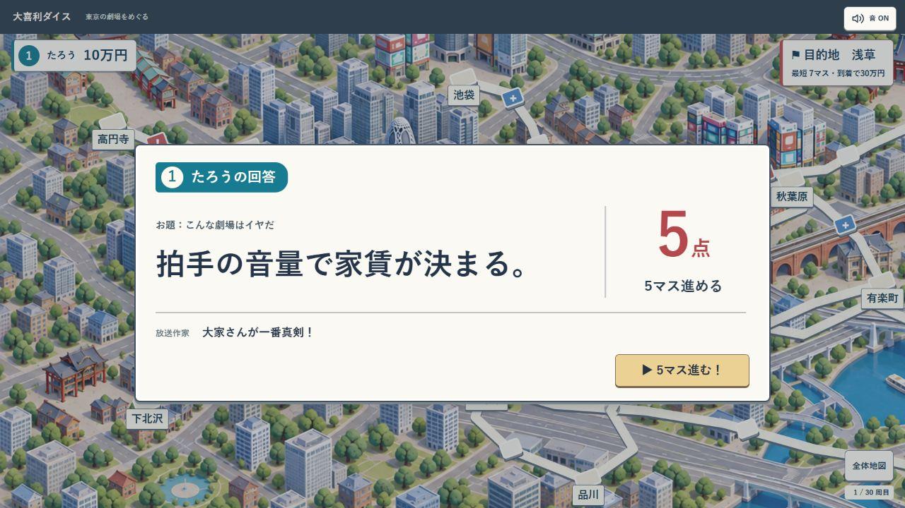

# 家庭用ゲーム表現の実装確認

2026-09-26。ユーザーが承認した最終画像を基準に実装。コードと素材はローカルの feature/web-rewrite に保持し、コミット・公開は行っていない。

## 変更

- タイトルは東京の小劇場。設定・オンライン待機室・手番を顔のない番号付きマイクコマに統一。旧列車、号車、乗車の表現と使われなくなったTravelArtを撤去。
- [背景素材](../../../app/public/art/tokyo-board-console.png)は内蔵image_genによる生成。元地図を参照して街・道路・水路の配置を保持し、細部と植生を簡略化。[生成プロンプト](map-prompt.md)。元のtokyo-board.pngは保持。
- マスは浅い角形、コマはマットな円筒。接続と移動候補の配置計算はそのまま。
- 回答発表はマップ上の白いカード。回答→点数と効果→放送作家の講評→操作。サイコロのシャッフルと大きな装飾を除いた。
- オンライン全員結果は順番にめくらず、全員の回答・点数・移動数・講評を同時に一覧表示。通常30秒・追加15秒・提出状態・操作権限・下書き保存・サーバーの進行を保持。
- テレビ局への到着はテレビ局の看板を表示。タイトルの共通説明から15秒の断定を外し、遊び方で1台15秒／オンライン通常30秒を区別。

## 検証結果

- baseline: 23 files / 108 tests pass。
- final: npm test --prefix app -- --maxWorkers=2 = 23 files / 108 tests pass。
- npm run build --prefix app = pass。
- npm run lint --prefix app = pass。
- git diff --check = pass。
- 実ブラウザのローカルゲームで、設定→手番待機→入力→採点→回答カード→候補Bの選択→決定まで確認。残り2マスから1マスへ進み、次の合法手に更新。確認用タブのerrorログなし。
- 1280×720 / 1100×640で通常発表と4人の結果一覧、4人待機室を確認。
- 390×640でタイトル、オンライン入口、通常発表、4人結果一覧、120文字の回答・長い講評・減額を確認。本文スクロールと独立した続行ボタンを維持。
- 844×390で通常発表と長文減額を確認。初回にCSS gridの自動縮小で本文・点数が見切れたため、結果本文の行をmax-contentに変更。修正後は本文266px／表示193pxのスクロールになり、Endキーで終端まで到達、講評と所持金下限0万円を読み取れる。
- オンラインの自動進行案内が600msの発表待機中に消える回帰は既存テストで検知して修正。
- 読み取りレビューの指摘2件（タイトルの秒数／テレビ局の看板）を修正。
- reducer、rules、Workerにはこの変更で編集を行っていない。state/rules/roomのハッシュは着手時と一致。

## 実装後の表示例

この画像は実際のReact部品と盤面を使う確認用データの画面。生成した完成予想図をゲーム画面へ貼り付けたものではない。

全員回答のネットワークE2Eや本番配信は、この見た目の変更では再実施していない。全員回答の描画・下書き・操作権限は既存テストと固定状態の画面確認で検証した。音楽の再作曲は行わず、既存の音制御・音量保存・背景停止・動き軽減を維持した。
